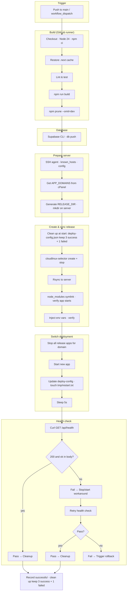

# Deploy workflow walkthrough and flowchart

This document walks through `.github/workflows/deploy.yml` step by step and provides a flowchart.

---

## Walkthrough

### Trigger and concurrency
- **Runs on:** push to `main` or manual workflow_dispatch.
- **Concurrency:** One deploy at a time per branch (`deploy-${{ github.ref }}`); a new run cancels any in-progress one.

### Phase 1: Build (on GitHub runner)
1. **Checkout** — Clone the repo.
2. **Setup Node.js 24** — With npm cache.
3. **Install dependencies** — `npm ci`.
4. **Restore Next.js build cache** — `.next/cache` from previous runs if key matches.
5. **Lint & test** — `npm run lint`, `npm test` (if present).
6. **Build** — `npm run build` (produces `.next/` including compiled `/api/health`).
7. **Prune** — `npm prune --omit=dev` so only production deps remain.

### Phase 2: Database (Supabase Cloud)
8. **Setup Supabase CLI** — Install `supabase` in the runner.
9. **Push migrations** — `supabase link` + `supabase db push` using repo secrets (no server involved).

### Phase 3: Prepare server (SSH)
10. **Setup SSH agent** — Load `SSH_PRIVATE_KEY` from secrets.
11. **Known hosts** — `ssh-keyscan` the cPanel host so SSH doesn’t prompt.
12. **SSH config** — Keepalive so long steps don’t drop.
13. **Get APP_DOMAINS** — SSH to server, run `uapi DomainInfo list_domains`, parse main/addon/parked domains; fail if none. Output is used as the domain to deploy to and to health-check.
14. **Guard APP_NAME** — Ensure `APP_NAME` is safe (alphanumeric, dash, underscore).
15. **Print deploy config** — Log host, app name, paths, domains (no secrets).
16. **Generate release dir** — `RELEASE_DIR=<short_sha>-<timestamp>` (e.g. `a1b2c3d-20250228120000`).
17. **Prepare release dir on server** — `mkdir -p ~/apps/<APP_NAME>-releases/<RELEASE_DIR>`.
18. **Clean up old releases at start** — Runs on every deploy. Reads `deploy-config.json` (creates from legacy `current`/`previous`/`successful`/`failed` if missing). Keeps only release dirs in `successful` and `failed`. Destroys and removes all other release dirs.
19. **Create Node.js app entry (disabled)** — On server: `cloudlinux-selector create` for this release’s app-root and first domain (Node 24, app-uri `/`), then `cloudlinux-selector stop` so the new app is registered but not running.
20. **Sync files via rsync** — From runner to server: repo contents into `~/apps/<APP_NAME>-releases/<RELEASE_DIR>/`. Excludes: `.git`, `.github`, `.ssh`, `next.config.ts` (server uses `next.config.mjs` so no TypeScript at runtime). You upload: `.next/`, `node_modules/`, `package.json`, `public/`, **`src/`** (required — Next.js looks for `app` or `src/app` at runtime), etc. After sync, a step replaces the real `node_modules` with a symlink for CloudLinux.
20b. **Verify app starts (dry run)** — On server, run `node app.js` with `PORT=3000` and `NODE_ENV=production` for up to 12s; fail the deploy if the app does not log "Next.js app ready".
21. **Inject env vars** — `cloudlinux-selector set` for this app-root: `ENV_API_KEY`, `SUPABASE_SECRET_KEY`, `SUPABASE_SERVICE_ROLE_KEY`, `N8N_WEBHOOK_SECRET`, `NODE_ENV=production`.
22. **Verify env** — `cloudlinux-selector get` and assert `ENV_API_KEY` is present; fail if not.

### Phase 5: Switch to new deployment
23. **Switch deployment** — On server, in order:
    - Read `deploy-config.json` (create with `current`/`previous`/`successful`/`failed` if missing). Set `previous = current`, `current =` new app root and write config.
    - **Stop all** Node apps for this domain under the releases dir: loop over each release dir (e.g. `[0-9a-f]*-[0-9]*`) and `cloudlinux-selector stop` for that app-root (same app-uri).
    - **Start** the new app: `cloudlinux-selector start` for `<RELEASE_DIR>`.
    - `mkdir -p` and `touch` the new app’s `tmp/restart.txt` (Passenger restart).
24. **Pause 5 seconds** — Give selector and Passenger time to apply the switch.

### Phase 6: Health check
25. **Health check** — From the runner (not from the server), `curl -k https://<FIRST_DOMAIN>/api/health`. Required: HTTP 200 and response body contains `"ok"` (so only the Node app passes, not static public_html). Up to 6 attempts, 5 seconds apart.
26. **If first run fails:** Workaround: SSH to server, `cloudlinux-selector stop` for the new app, sleep 3, `cloudlinux-selector start` for the new app, sleep 10, then retry the same health check (6 attempts again).
27. **If health check still fails:** Update `deploy-config.json`: set `failed` to this release’s app root. Trigger rollback (step 29). Rollback leaves the failed deployment on disk for debug.

### Phase 7: Success or failure
28. **Record successful and clean up (if success)** — Update `deploy-config.json`: prepend this release to `successful` (keep max 3). Then remove any release dir not in `successful` and not in `failed`; destroy those app entries and delete the dirs.
29. **Trigger rollback (if health check failed)** — POST to GitHub API to run `rollback.yml` on `main`. Rollback reverts to `previous` but does not destroy or remove the failed deployment.

---

## Flowchart (Mermaid)

---

## Retention: last 3 successful, 1 failed

- **`deploy-config.json`** (in the releases dir) — Single JSON file with `format_version`, `current`, `previous`, `successful` (array of app-root paths, newest first, max 3), and `failed` (single path or null). The server must have **`jq`** for the workflow to read and update it. Updated on switch (current/previous), on success (successful), and on health-check failure (failed).
- **Cleanup at start** (step 18) and **on success** (step 28) remove any release dir that is not in `successful` and not in `failed`. So you keep **last 3 successful** deployments and **only the most recent failed** one for debug.
- **Rollback** reads/writes `deploy-config.json` (reverts `current` to `previous`). It does not destroy or remove the failed deployment; it stays on disk until the next deploy’s cleanup (which keeps it as the single “failed” slot if it’s still the most recent failure).

---

## Why the health check can fail

The health check **only passes** when:

- The request goes to **your Node (Next.js) app**, and  
- That app responds with **HTTP 200** and a body containing **`"ok"`** (from `GET /api/health`).

It **fails** when, for example:

1. **Traffic still goes to public_html** — Apache/document root still serves static files (e.g. your debug `index.html`) or a 404 for `/api/health`. The workflow correctly rejects that.
2. **Traffic still goes to the old app** — The server didn’t switch to the new release after “Switch deployment”; only the old app (or nothing) is running for that domain.
3. **New app not listening or crashing** — The new app root was started but the process isn’t bound to the right port or crashes before answering (e.g. env or startup error). Then `/api/health` may time out or 5xx.
4. **SSL/host/network** — `curl -k` ignores cert errors; if the domain doesn’t resolve or the host blocks the runner, you get connection errors and no 200.

So “health check failed” after this workflow almost always means: **the server is not successfully serving the new Node app at `https://<FIRST_DOMAIN>/api/health`.** Next steps are: confirm on the server that the new app is started and that the domain’s document root / vhost is set to use the Node app (and if needed, Apache reload as in DEPLOYMENT.md).
